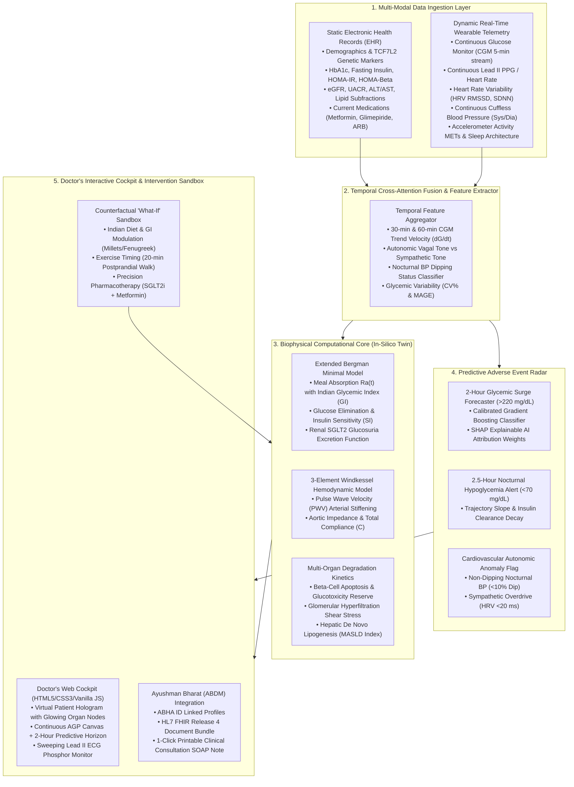

# AAYU-TWIN Technical Architecture Specification
## Multi-Scale Healthcare Digital Twin for the Indian Phenotype
**Happiest Health Digital Twin Challenge 2026**

---

## 1. System Topology & End-to-End Pipeline

---

## 2. Mathematical Formulations & Biophysical Differential Equations

### 2.1 Extended Bergman Minimal Model with Indian Phenotypic Adjustments
The metabolic subsystem is governed by three coupled differential equations:

$$\frac{dG(t)}{dt} = -(p_1 \cdot \eta_{\text{met}} + X(t) + E_{\text{uptake}}) G(t) + p_1 G_b + \frac{R_a(t)}{V_g} - \frac{\Phi_{\text{SGLT2}}(G)}{V_g}$$

$$\frac{dX(t)}{dt} = -p_2 X(t) + p_3 \max(0, I(t) - I_b)$$

$$\frac{dI(t)}{dt} = -n (I(t) - I_b) + \beta_{\text{reserve}} \cdot \gamma \cdot \max(0, G(t) - h) + \frac{I_{\text{exo}}(t)}{V_i}$$

#### Variable & Parameter Definitions:
- $G(t)$: Plasma glucose concentration ($\text{mg/dL}$).
- $X(t)$: Insulin action in the remote interstitial compartment ($\text{min}^{-1}$).
- $I(t)$: Plasma insulin concentration ($\mu\text{U/mL}$).
- $G_b, I_b$: Basal fasting glucose and insulin levels ($\text{mg/dL}, \mu\text{U/mL}$).
- $p_1$: Glucose-mediated glucose clearance factor ($\sim 0.024\text{ min}^{-1}$).
- $p_2$: Insulin action disappearance rate constant ($\sim 0.025\text{ min}^{-1}$).
- $p_3$: Insulin action sensitivity parameter ($p_3/p_2 = S_I$, the Insulin Sensitivity Index). In the Indian phenotype, $S_I$ is clinically attenuated by 45% due to visceral adiposity and ectopic liver fat.
- $\eta_{\text{met}}$: Hepatic gluconeogenesis reduction factor under Metformin therapy ($\eta_{\text{met}} \approx 0.78$).
- $E_{\text{uptake}}$: Insulin-independent glucose uptake via skeletal muscle GLUT4 translocation stimulated by postprandial physical activity:
  $$E_{\text{uptake}} = k_{\text{walk}} \cdot \left(\frac{G(t)}{G_b}\right) \cdot 0.015$$
- $\Phi_{\text{SGLT2}}(G)$: Renal proximal tubule glucose excretion rate under SGLT2 inhibitor therapy (e.g. Dapagliflozin/Empagliflozin). At $G > 100\text{ mg/dL}$, $\Phi_{\text{SGLT2}} \approx 55\text{ mg/min}$ ($\sim 79.2\text{ g/day}$).

### 2.2 Gastrointestinal Meal Absorption Function $R_a(t)$ Calibrated for Indian Diets
To capture the rapid postprandial glucose surges induced by traditional high-glycemic Indian meals (e.g., polished Sona Masoori white rice, refined maida naan) versus low-GI alternatives (foxtail millet, ragi, fenugreek seeds), the glucose appearance rate $R_a(t)$ is modeled as a two-compartment gamma-transit function:

$$R_a(t) = \sum_{m \in \text{Meals}} \mathbb{I}(t \ge t_m) \cdot \left[ \frac{D_m \cdot f \cdot 1000}{t_{\text{peak}}^2} \right] (t - t_m) \cdot \exp\left(-\frac{t - t_m}{t_{\text{peak}}}\right)$$

Where:
- $D_m$: Carbohydrate intake for meal $m$ in grams.
- $f$: Intestinal bioavailability factor ($f = 0.90$).
- $t_{\text{peak}}$: Time to peak gastrointestinal absorption, inversely scaled by the Glycemic Index ($\text{GI}$):
  $$t_{\text{peak}} = \frac{t_{\text{base}}}{\text{GI} / 70.0}$$
  - **High-GI Indian Diet (White Rice / Naan / Sugar Tea):** $\text{GI} \approx 78 \implies t_{\text{peak}} \approx 40\text{ min}$ (produces steep spike).
  - **Low-GI Indian Diet (Millets / Fenugreek / Sprouted Salad):** $\text{GI} \approx 48 \implies t_{\text{peak}} \approx 65\text{ min}$ (produces blunted, sustained curve).

### 2.3 Cardiovascular 3-Element Windkessel Model & Arterial Stiffness
Arterial hemodynamic dynamics are governed by:

$$\frac{dP(t)}{dt} = \frac{Q(t)}{C} - \frac{P(t) - P_v}{R_p \cdot C}$$

Where:
- $P(t)$: Central aortic pressure ($\text{mmHg}$).
- $Q(t)$: Left ventricular stroke output flow.
- $C$: Total arterial compliance ($\text{mL/mmHg}$). In patients with elevated Pulse Wave Velocity ($\text{PWV} > 9.0\text{ m/s}$), compliance drops by $30\%$, augmenting pulse pressure and microvascular shear stress.
- $R_p$: Systemic peripheral vascular resistance.
- $P_v$: Central venous pressure ($\sim 4\text{ mmHg}$).

---

## 3. Multi-Modal Fusion & Predictive Advers Event Pipeline

The predictive engine ingests a fused 11-dimensional feature vector $\mathbf{z}_t$:

$$\mathbf{z}_t = \big[ \text{HbA1c}, \text{HOMA-IR}, \text{eGFR}, \text{Age}, G(t), \left.\frac{dG}{dt}\right|_{30\text{m}}, \overline{\text{HR}}_{60}, \overline{\text{HRV}}_{60}, P_{\text{sys}}(t), P_{\text{dia}}(t), \Delta t_{\text{sleep\_debt}} \big]$$

### 3.1 Two-Hour Postprandial Glucose Surge Classifier
Trained gradient boosting trees output the probability $\mathcal{P}(\text{Spike} > 220\text{ mg/dL} \mid \mathbf{z}_t, \text{Carbs}_{\text{meal}})$:

$$\mathcal{P}_{\text{surge}} = \sigma\left( \sum_{k=1}^K f_k(\mathbf{z}_t) \right)$$

With SHAP (SHapley Additive exPlanations) values computed in real-time to provide clinicians with intelligible physiological attribution:
$$\phi_j = \sum_{S \subseteq F \setminus \{j\}} \frac{|S|! (|F| - |S| - 1)!}{|F|!} \left[ f(S \cup \{j\}) - f(S) \right]$$

### 3.2 Nocturnal Hypoglycemia Forecaster
Tracks the first and second derivatives of the continuous glucose monitor telemetry between 22:00 and 06:00 IST. If:
$$G(t) < 110\text{ mg/dL} \quad \text{AND} \quad \frac{dG}{dt} < -0.40\text{ mg/dL/min}$$
The early-warning system triggers a critical alert with estimated time-to-crash $\tau_{\text{hypo}} = \frac{G(t) - 70.0}{|dG/dt|}$ minutes, providing actionable time for oral carbohydrate or medication dose tapering.

---

## 4. Ayushman Bharat (ABDM) Integration & Data Governance

### 4.1 ABDM FHIR R4 Bundle Specification
AAYU-TWIN produces HL7 FHIR Release 4 document bundles compatible with National Health Authority (NHA) specifications:

| FHIR Resource | Standard Terminology | Code / Identifier | Clinical Meaning |
|---|---|---|---|
| **Patient** | ABDM ABHA | `91-4521-8839-0129@abdm` | Ayushman Bharat Health Account |
| **Condition** | SNOMED CT | `44054006` | Type 2 Diabetes Mellitus |
| **Condition** | SNOMED CT | `38341003` | Essential Hypertension (Non-Dipper) |
| **Observation** | LOINC | `4548-4` | HbA1c in Blood |
| **Observation** | LOINC | `15074-8` | Fasting Glucose in Blood |
| **Observation** | NRCeS Custom | `digital-twin-analytics` | In-Silico Counterfactual Multi-Organ Prognosis |
| **MedicationRequest** | RxNorm / Indian Pharmacopoeia | `Dapagliflozin 10mg OD` | SGLT2 Inhibitor Cardiorenal Protection |

### 4.2 Data Sandbox Rules & DPDP Act 2023 Compliance
In accordance with challenge guidelines and the **Digital Personal Data Protection (DPDP) Act 2023 (India)**:
1. **Synthetic Cohort Generation:** No patient identifying health information (PII/PHI) is stored or processed. All datasets are created using Synthea-derived Markov demographic generators calibrated to Indian epidemiological constants.
2. **Local Edge Inference:** The web dashboard embeds an in-browser numerical solver (`public/js/biophysical_engine.js`) using 4th-order Runge-Kutta numerical integration, allowing entire simulations to execute on edge devices without transmitting sensitive telemetry over external networks.
